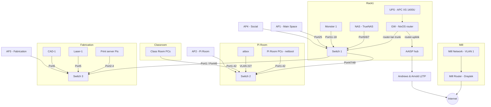
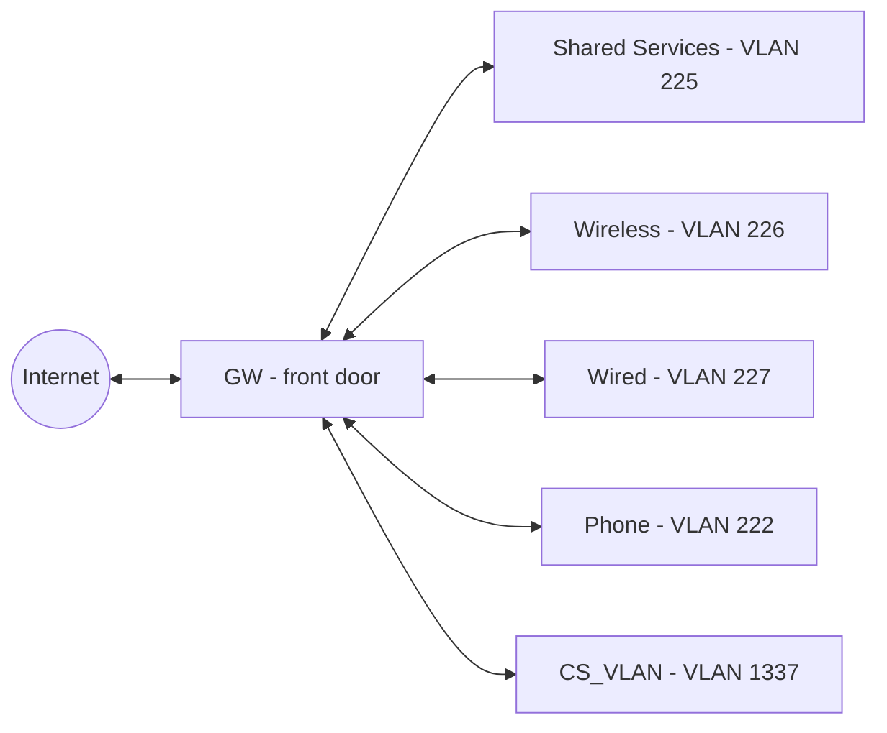

# Network Layout

## Physical Network Layout

Port numbers are a habit rather than a record: `show running-config` on the switch (or
[switch-gui](devices/network_switches/index.md)) is the only authority on what is patched
where.

## Hardware

| Name         | Manf         | Model                   | Type      | Location      | Status | Notes                                              |
| ------------ | ------------ | ----------------------- | --------- | ------------- | ------ | -------------------------------------------------- |
| GW           | Supermicro   | X9SCM (Xeon E3-1220 v2) | Router    | Rack 1        | Live   | NixOS, see [gateway](devices/gateway/index.md)     |
| services1    | HP           | ProDesk 600 G3 SFF      | Server    | Rack 1        | Live   | NixOS, most of our services                        |
| services2    | Gigabyte     | AB350 Gaming-ITX/ac     | Server    | Rack 1        | Live   | NixOS, RTX 3060 inference                          |
| services3    | ASUS         | Z170 PRO GAMING         | Server    | Bench         | Live   | NixOS, GTX 1080 Ti inference, on Wi-Fi for now     |
| aibox        | GMKtec       | NucBox M6               | Server    | Pi Room       | Live   | NixOS, the network's build machine, netboots the Pi Room PCs |
| Switch 1     | HP           | Procurve 2510-48G       | L2 Switch | Rack 1        | Live   | Core switch, VLANs tagged on the GW uplink         |
| Switch 2     | HP           | Procurve 2510-48G       | L2 Switch | Rack 1        | Live   | Wired clients in the rooms                         |
| Switch 3     | HP           | Procurve 2824           | L2 Switch | Fabrication   | Live   | Fabrication area                                   |
| AP1          | Ubiquiti     | U7PG2                  | AP        | Main Space    | Live   | UniFi, adopted, replaced 2026-10-31                |
| AP2          | Ubiquiti     | U7LT                   | AP        | Pi Room       | Live   | UniFi, adopted                                     |
| AP3          | Ubiquiti     | U7LT                   | AP        | Fabrication   | Live   | UniFi, adopted                                     |
| AP4          | Ubiquiti     | U7LT                   | AP        | Social Space  | Live   | UniFi, adopted                                     |
| NAS          | HP           | MicroServer Gen8        | NAS       | Rack 1        | Live   | TrueNAS, NFS + SMB + the borg backup server        |
| Monster 1    | HP           | SL2x170z G6 blade       | Server    | Rack 1        | Live   | Proxmox VE 9, the only node in use, see [proxmox](devices/proxmox/index.md) |
| UPS          | APC          | Back-UPS XS 1400U       | UPS       | Rack 1        | Live   | On the router's USB port, drives the fleet shutdown |
| NAS 1        | QNAP         | TS-431+                 | NAS       | Rack 1        | Dead   | Retired 2026, see [nas](devices/nas/index.md)      |
| Leigh OOB    | Raspberry Pi | 2 B+                    | Server    | Rack 1        | Gone   | Replaced by the tailnet                            |
| Monster 2-5  | HP           | -                       | Server    | Rack 1        | Gone   | Only one Proxmox node is in use                    |

The SSIDs and the APs are managed by a UniFi "OS Server" appliance running in
containers on services1, at
[unifi-admin.int.leighhack.org](https://unifi-admin.int.leighhack.org). The older
Linksys, BT, and Cisco access points that used to be here are gone.

## L3 Layout / VLANs

TL;DR: every VLAN is routed by GW, all of them can reach Shared Services, and the
only way in from outside is the [front door](devices/gateway/index.md#the-front-door) on
GW. The old Automation, DMZ, Storage, and AD Lab VLANs were dropped when the router was
rebuilt; what they were used for now lives somewhere else, noted below.

The VLANs, their blocks, and the dynamic DHCP range each one hands out, are one table in
the repo (`common/vlans.nix`); the fixed addresses below are another (`common/dns-records.nix`).
Both are rendered into dnsmasq's config on the router at deploy time, so a device and a
name are each one line in one file.

### Mill Network - VLAN '1'

The mill provides internet access via a 100mbps internal network. It can be a bit unreliable but it works for our general usage.

* ISP: [Awareness Software Ltd](https://aware-soft.com/) (AS34931)
* Mill Network Administrator: [Mark Nightingale](mailto:data@imagevillage.co.uk), Image Village.

Access to the mill network is provided by a singular CAT5 delivered to the rear of the main space, just above where Rack 1 is.

* VLAN: 1 (untagged)
* Subnet: `192.168.20.0/24`
* Gateway: `192.168.20.1`
* DHCP Enabled

Usage is bound by the [LBPT Tenant Network Agreement](mill_network_tc.md).

### Shared Services - VLAN 225

Where the servers, routers, and other central bits are hosted. Everything the flake
deploys answers here.

IP Range: `10.3.1.0/24`, DHCP `10.3.1.150 - 10.3.1.253`

| Device Name       | IP Address  | Notes |
| ----------------- | ----------- | ----- |
| GW                | `10.3.1.1`  | The router, VLAN 225's address is its own |
| Switch 1          | `10.3.1.2`  | |
| Switch 2          | `10.3.1.3`  | |
| Switch 3          | `10.3.1.4`  | Fabrication |
| NAS               | `10.3.1.6`  | TrueNAS, still answers to `nas2` |
| services1         | `10.3.1.20` | |
| services2         | `10.3.1.21` | |
| Monster 1         | `10.3.1.11` | Proxmox |
| Apps1             | `10.3.1.30` | Proxmox VM, mostly superseded |
| aibox             | `10.3.1.32` | |
| Authentik         | `10.3.1.36` | A **second address on services1**, not a box - see [authentik](devices/authentik/index.md) |
| Web1              | `10.3.1.39` | Proxmox VM, the hackspace website previews |
| AP1 - Main Space  | `10.3.1.41` | APs are on the wired run, so they get 225 addresses |
| AP2 - Pi Room     | `10.3.1.42` | |
| AP3 - Fabrication | `10.3.1.43` | |
| AP4 - Social      | `10.3.1.44` | |
| Intercom          | `10.3.1.166` | Asterisk, a second address on services1 |

Two things about that table that are easy to get wrong. `10.3.1.36` and `10.3.1.166` are
not machines: they are extra addresses on services1, kept because the ProCurve switches
and the phone handsets have those numbers typed into them and can't be reconfigured.
And `10.3.1.5` (`NAS 1`, the QNAP) is still reserved but does not answer.

### Wireless - VLAN 226

Wireless clients, cameras, and anything networked that only has Wi-Fi.

IP Range: `10.3.2.0/24`, DHCP `10.3.2.100 - 10.3.2.253`

| Device Name | IP Address  | Location |
| ----------- | ----------- | -------- |
| SLZB-06M    | `10.3.2.2`  | Zigbee coordinator (PoE) |
| Cam1        | `10.3.2.6`  | |
| Cam5        | `10.3.2.10` | Pi Room |
| Cam8        | `10.3.2.11` | Main Space |
| Cam7        | `10.3.2.12` | CNC |
| Cam9        | `10.3.2.17` | Social Space |
| Sumup Solo  | `10.3.2.15` | Card terminal |
| Big Button  | `10.3.2.21` | The [state switch](devices/state_switch/index.md) |
| Brother     | `10.3.2.30` | MFC-L3740CDW, the member printer |
| Voron       | `10.3.2.50` | |
| Elegoo      | `10.3.2.55` | Resin printer |
| Snapmaker   | `10.3.2.56` | |
| CNC-1       | `10.3.2.61` | |
| LED strips  | `10.3.2.70`, `10.3.2.71` | `led180`, `led-pi-room` |
| services3   | `10.3.2.213` | On the bench, so this is its Wi-Fi lease |

Cameras 2, 3, 4 and 6 are gone; what's left is the four OpenIPC/thingino cameras plus
`cam1`. Each of them is on Wi-Fi, and a camera's picture quality is a property of the
access point it happens to have joined, so read the cell before blaming the camera.

Channel plans are chosen by the UniFi controller rather than written down, and they
change; ask infra for a current read if a camera or a printer is being awkward.

### Wired - VLAN 227

The general hackspace wired network. This covers the Pi Room, Classroom, Electronics, and Fabrication.

IP Range: `10.3.14.0/24`, DHCP `10.3.14.150 - 10.3.14.253`

| Device Name | IP Address | Notes |
| ----------- | ---------- | ----- |
| workshop / main_space / woodwork | `10.3.14.11` / `.12` / `.13` | The room panels |
| aibox (wired) | `10.3.14.32` | aibox's second NIC, on the Pi Room run |
| CAD-1 | `10.3.14.51` | |
| 3d-lime / 3d-blue | `10.3.14.61` / `10.3.14.62` | Klipper print servers, fixed by IP on purpose |
| PI-ROOM-01 ... PI-ROOM-10 | `10.3.14.101` - `.110` | Netbooted from aibox, no local disk |

### Phone - VLAN 222

IP Range: `10.3.22.0/24`, no dynamic range - a device arriving on it gets no lease, which
is the point of the VLAN existing. The handsets and the intercom are on fixed addresses.

### CS_VLAN - VLAN 1337

The other network in the building, arriving on the router's LAN trunk with its own tag:
`192.168.2.0/24`, DHCP `192.168.2.150 - 192.168.2.250`. GW routes it but owns none of its
addresses.

### IPv6

AAISP delegate `2001:8b0:1d14::/48`, and each VLAN gets a `/64` named after it
(`2001:8b0:1d14:225::/64`, `...226::/64`, and so on) alongside a ULA in
`fd99:dead:beef:<vlan>d::/64`. Addresses are SLAAC via router advertisements; all IPv6
leaves through the AAISP tunnel, so if that tunnel is down the network has no IPv6 at all.

### Retired

* **Automation - VLAN 229** (`10.3.16.0/24`): dropped at the 2026-10-21 router cutover. The door system and the automation run from services1 now.
* **DMZ - VLAN 230** (`81.187.195.16/29`): the AAISP `/29` is not a VLAN, it's routed to the tunnel. Nothing is published except through the front door.
* **Storage - VLAN 231**: never implemented, and now moot.
* **AD Lab - VLAN 232** (`192.168.10.0/24`, [GOAD](https://github.com/leigh-hackspace/GOAD)): the lab VMs are stopped and the VLAN is not created.

## Out of Band Access

'Leigh OOB' and its Tailscale-on-a-Pi are gone. Every flake machine, the switches (over
the LAN only), and the router are reachable over the [tailnet](vpn.md), and the router,
the uplinks, the leases and the live connection table are all visible at
[network-info.int.leighhack.org](https://network-info.int.leighhack.org).
